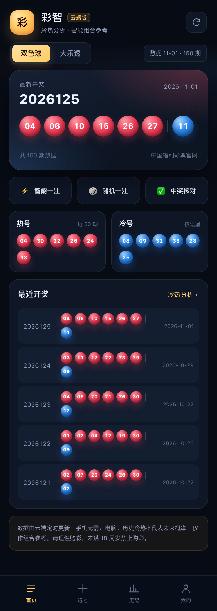
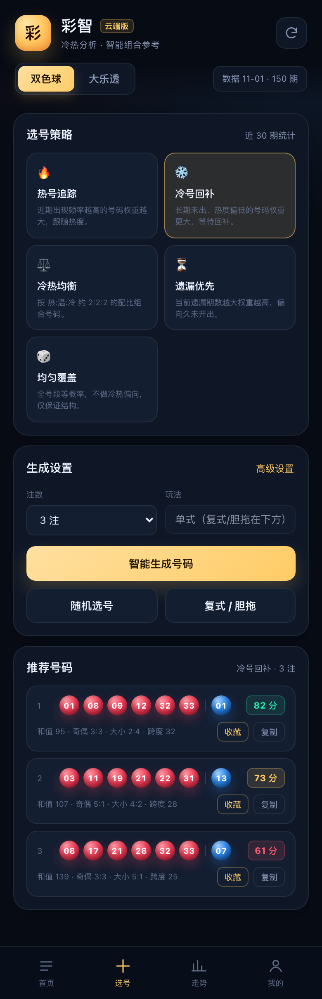
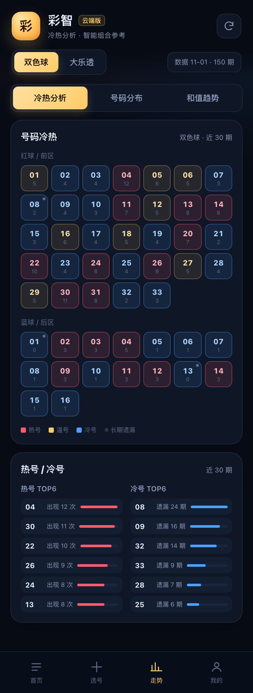
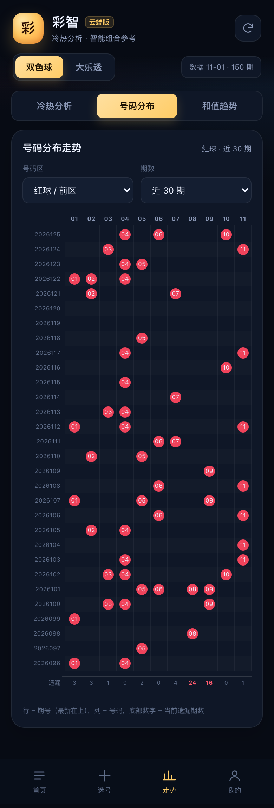
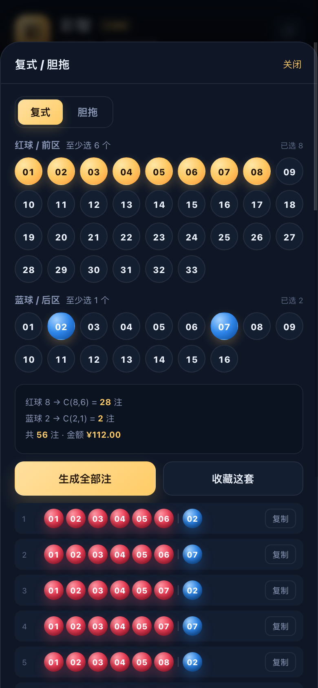
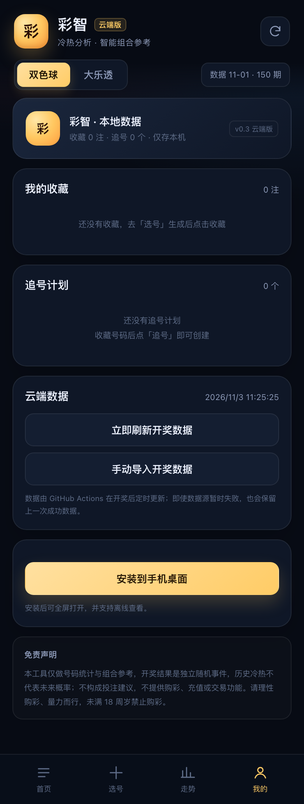

# 彩智 · 云端选号助手

重新设计的双色球 / 大乐透手机端 PWA。与旧版最大的区别：**页面和开奖数据都托管在云端，手机不需要开电脑、不需要本地服务或临时隧道**。

> 仅用于号码统计与组合娱乐，不构成投注建议，不提供购彩/充值/交易功能。请理性购彩，未满 18 周岁禁止购彩。

## 线上地址（部署后）

- 永久地址：`https://d6688.github.io/lottery-cloud/`
- 手机安装：手机浏览器打开后「添加到主屏幕 / 安装应用」，可离线打开。
- 数据更新：由 GitHub Actions 定时抓取，开奖后约 20-40 分钟内更新；页面顶部显示数据日期与期数。

## 重新设计要点

- **手机优先**：底部 4 个标签（首页 / 选号 / 走势 / 我的），390px 宽度设计，桌面端居中手机壳展示。
- **核心保留**：双色球/大乐透、冷热/遗漏分析、5 种智能策略、结构约束、随机选号、复式/胆拖、走势图、中奖核对、收藏、追号计划。
- **视觉重做**：深蓝夜空 + 金色号码球，全新图标与卡片布局。
- **架构重做**：去掉本地 Node 服务与 tunnel，改为纯静态托管 + GitHub Actions 更新数据；手机端永远有一个固定 HTTPS 网址。
- **文案收敛**：以「统计组合参考」替代「精准号码/预测」表述，保留免责声明。

## 功能

| 页面 | 内容 |
| --- | --- |
| 首页 | 最新开奖、数据日期/期数、冷热速览、快捷（智能一注 / 随机一注 / 中奖核对）、最近 5 期 |
| 选号 | 5 种策略、1/3/5/10 注、奇偶/大小/和值/连号高级约束、结构评分、收藏/复制、随机、复式胆拖 |
| 走势 | 冷热分析（红/蓝球热力图、热号/冷号榜）、号码分布矩阵、和值/奇偶趋势 |
| 我的 | 收藏、追号计划、云端数据状态/刷新、手动导入、安装 PWA、免责声明 |

## 截图

| 首页 | 选号 |
| --- | --- |
|  |  |

| 冷热分析 | 号码分布 |
| --- | --- |
|  |  |

| 复式胆拖 | 我的 |
| --- | --- |
|  |  |

## 本地预览

```bash
cd lottery-cloud
node server.js          # http://localhost:8100
```

## 云端架构

```text
GitHub 仓库（D6688/lottery-cloud）
├── main 分支
│   ├── index.html / assets / data/latest.json / assets/snapshot.js
│   └── .github/workflows/
│       ├── deploy.yml          # push 后构建并发布 GitHub Pages
│       └── update-data.yml     # 每天开奖后抓数据 + 提交 + 重新发布
├── GitHub Actions
│   ├── 13:40 / 14:10 UTC（北京时间 21:40 / 22:10，开奖后约 20-40 分钟）
│   └── scripts/update-data.js 抓取福彩官网 / 500 彩票网，合并后写入静态 JSON
└── GitHub Pages（HTTPS / PWA / 全球 CDN）
```

- 开奖数据先写入 `data/latest.json` 与 `assets/snapshot.js`，页面优先 fetch 最新 JSON，失败时回退到 PWA 缓存/内置快照。
- 数据源失败时脚本保留上一次成功数据，不会清空。
- 手动「导入开奖」只保存在手机本机，不影响云端。

## 测试

```bash
node tests/test.js
node tools/capture.sh   # 需要本地 Chrome；页面检查 + 截图
```

当前：**1419 项断言通过**，覆盖快照合法性、冷热统计、5 种策略、结构约束、复式/胆拖注数、中奖奖级、导入合并、PWA/页面检查。

## 部署（由代理执行，需要仓库授权）

代码已经准备在一个本地 Git 仓库中。首次部署需要一次 GitHub 授权，二选一：

1. **临时 token（推荐）**：在 GitHub 生成 classic token（勾选 `repo` + `workflow`，有效期 1 天），保存到项目根目录 `.deploy-token` 文件，代理读取后部署并删除该文件，之后你可立即在 GitHub 撤销 token。
2. **gh 登录**：在本机终端执行 `brew install gh`，然后 `GH_CONFIG_DIR="$PWD/.gh" gh auth login`，把登录态放在项目目录内，代理即可创建仓库、推送并开启 Pages。

部署完成后：创建 `D6688/lottery-cloud` 仓库、推送 main、开启 Pages、触发一次数据任务，验证公网 HTTPS、PWA 安装与数据更新。

## 目录

```text
lottery-cloud/
├── index.html
├── manifest.webmanifest
├── service-worker.js
├── assets/               # 样式、算法、页面逻辑、云端快照
├── data/latest.json      # 云端开奖数据（Actions 更新）
├── scripts/              # 抓取与更新脚本
├── .github/workflows/    # Pages 部署 + 定时数据更新
├── tests/test.js
├── tools/                # 截图、图标
└── screenshots/
```

## 数据来源

- 双色球：中国福利彩票官网开奖公告接口
- 大乐透：500 彩票网历史数据页

数据源可能调整或限流，若 Actions 抓取失败会保留旧数据；也可页面手动导入。
